# `lib_adsb` — High-Fidelity ADS-B / Mode S / UAT Synthesis, Impairment, Decoding & Tracking Library

`lib_adsb` is a comprehensive, strictly typed Python 3.11+ library for **end-to-end simulation, physical-layer/avionics error injection, protocol decoding, and multi-target state estimation** of Automatic Dependent Surveillance–Broadcast (ADS-B), Mode S (1090 MHz), and Universal Access Transceiver (978 MHz UAT) traffic.


**Launch** with: **" python -m uvicorn adsb.api.app:app --host 0.0.0.0 --port 8000 --reload "** and add aircraft for tracks using **"python scripts\generate_flights.py --number 100"** for a once off boost in aircraft or **"python scripts\constant_flight_generator.py"** to continuously create departures form all airports in he simulation based on how busy the airport would normally be.  

It is designed around a **closed-loop architecture**:
1. **Synthesize** multi-aircraft 4D flight trajectories (from gate pushback to touchdown rollout) using realistic aircraft performance profiles, LNAV/VNAV waypoint routing, and atmospheric wind models, and encode them into authentic schedule-driven ADS-B / Mode S / UAT bitstreams.
2. **Impair** the transmitted bitstreams through realistic RF channel conditions (line-of-sight horizon & terrain masking, free-space path loss, overlapping FRUIT/garble collisions, bit error bursts) and avionics failure modes (CPR odd/even cache desync, Gillham altitude encoder stuck bits, stale GPS caches, spoofing/ghost injection).
3. **Decode** raw frames from multiple industry wire formats (Raw AVR `*8D...;`, Mode S Beast Binary, SBS-1 BaseStation CSV, UAT hex, JSON) with full 24-bit CRC validation (`0xFFF409`), syndrome error correction, and stateless extraction of all 1090ES Type Codes (DO-260B/C), Mode S replies (DF4/5/11/20/21 + Comm-B BDS registers), and 978 MHz UAT messages.
4. **Track** aircraft over time in a stateful multi-target tracker featuring Global/Local Compact Position Reporting (CPR) state machines, Interacting Multiple Model (IMM) Kalman Filtering (Constant Velocity + Coordinated Turn in local ENU coordinates), track lifecycle management, and kinematic/protocol anomaly detection.

---

## Closed-Loop System Architecture

```mermaid
flowchart LR
    subgraph Synthesis ["1. Flight & Squitter Synthesis (adsb.synthesis)"]
        FP["Flight Plan\n(Origin, Dest, Waypoints,\nAircraft Type, Weather)"] --> KIN["4D Kinematic Engine\n(LNAV/VNAV + BADA Physics)"]
        KIN --> SCHED["DO-260C / UAT\nSquitter Scheduler"]
        SCHED --> ENC["Bit-Level Encoder\n(1090ES / Mode S / UAT)"]
    end

    subgraph Impairment ["2. RF & Avionics Impairment (adsb.impairment)"]
        AV_ERR["Avionics Faults\n(Stale GPS, CPR Desync,\nGillham Glitch, Spoofing)"] -.-> ENC
        ENC --> RF_CHAN["Multi-Receiver RF Channel\n(LOS Horizon, FSPL, SNR,\nGARBLE/FRUIT, Bit Errors)"]
    end

    subgraph Wire ["Wire Formats (adsb.wire)"]
        RF_CHAN --> WIRE["AVR / Beast Binary /\nSBS-1 / UAT / JSON"]
    end

    subgraph Decoder ["3. Protocol Decoder (adsb.protocol)"]
        WIRE --> CRC["CRC-24 (0xFFF409) &\nReed-Solomon Validator"]
        CRC --> DEC["Stateless Frame Decoder\n(DF0-24, TC1-31, BDS, UAT)"]
    end

    subgraph Tracker ["4. Stateful Multi-Flight Tracker (adsb.tracker)"]
        DEC --> CPR_RES["Stateful CPR Resolver\n(Global Even/Odd + Local)"]
        CPR_RES --> IMM["IMM Kalman Filter\n(CV + Coordinated Turn)"]
        IMM --> ANOM["Track Lifecycle &\nAnomaly / Spoof Detector"]
    end

    KIN -. "Ground Truth Evaluation\n(RMSE, Continuity, False Tracks)" .-> ANOM
```



---

## Documentation Suite

This repository is structured for **Specification-Driven AI Development**. 

1. **[`docs/01_ARCHITECTURE_AND_DESIGN.md`](docs/01_ARCHITECTURE_AND_DESIGN.md)** — Package directory tree, core domain models, coordinate reference systems (WGS84 $\leftrightarrow$ ECEF $\leftrightarrow$ Local ENU), geodesy equations, and pipeline interfaces.
2. **[`docs/02_PROTOCOL_SPECIFICATION.md`](docs/02_PROTOCOL_SPECIFICATION.md)** — Complete bit-level reference for Mode S (DF 0, 4, 5, 11, 16, 17, 18, 20, 21, 24), 1090ES Type Codes (TC 1–31), Comm-B BDS registers, CPR math (`NL(lat)` exact formula, encoding & decoding), Gillham Gray code, 24-bit CRC polynomial, 978 MHz UAT, and wire codecs (AVR, Beast, SBS-1).
3. **[`docs/03_FLIGHT_SYNTHESIS_AND_PHYSICS.md`](docs/03_FLIGHT_SYNTHESIS_AND_PHYSICS.md)** — Aircraft performance database, ISA atmosphere and wind models, LNAV great-circle & turn anticipation geometry, VNAV flight phase state machine, and DO-260B/C transmit interval timers.
4. **[`docs/04_ERROR_AND_ANOMALY_SIMULATION.md`](docs/04_ERROR_AND_ANOMALY_SIMULATION.md)** — Mathematical models for RF propagation, line-of-sight horizon & terrain obstruction, Poisson FRUIT interference, overlapping frame GARBLE bit corruption, transponder bugs, and adversarial spoofing profiles.
5. **[`docs/05_TRACKING_AND_STATE_ESTIMATION.md`](docs/05_TRACKING_AND_STATE_ESTIMATION.md)** — Stateful CPR position reconstruction, track association & lifecycle state machine, IMM Kalman Filter equations, BDS inference, and anomaly/spoofing detection heuristics.
6. **[`docs/06_IMPLEMENTATION_ROADMAP_AND_TESTING.md`](docs/06_IMPLEMENTATION_ROADMAP_AND_TESTING.md)** — Phased implementation plan (Phases 0–7), golden test vectors, `hypothesis` property-based test invariants, and closed-loop benchmark scenarios.

---

## Target Public API Preview

```python
import numpy as np
from adsb.geodesy import GeoPoint
from adsb.synthesis import FlightPlan, Waypoint, ScenarioSimulator, AircraftProfileDB
from adsb.impairment import ReceiverSite, ImpairmentPipeline, RFChannelConfig, AvionicsFaultConfig
from adsb.wire import BeastCodec, AVRCodec
from adsb.protocol import decode_frame
from adsb.tracker import MultiTargetTracker, TrackerConfig

# 1. Define a deterministic RNG
rng = np.random.default_rng(seed=42)

# 2. Create a Flight Plan (KJFK -> EGLL on a Boeing 777-300ER)
plan = FlightPlan(
    icao_hex="A1B2C3",
    callsign="BAW112",
    squawk="2451",
    aircraft_type="B77W",
    origin=GeoPoint(lat_deg=40.6413, lon_deg=-73.7781, alt_msl_m=4.0),
    destination=GeoPoint(lat_deg=51.4700, lon_deg=-0.4543, alt_msl_m=25.0),
    departure_time_s=0.0,
    cruise_alt_ft=37000.0,
    cruise_mach=0.84,
    waypoints=[
        Waypoint(name="MERIT", lat_deg=41.3819, lon_deg=-72.6917, target_alt_ft=18000.0),
        Waypoint(name="PUT", lat_deg=41.9556, lon_deg=-71.8441, target_alt_ft=29000.0),
        Waypoint(name="TOPPS", lat_deg=45.3400, lon_deg=-67.7381, target_alt_ft=37000.0),
    ],
)

# 3. Configure RF Receiver & Impairment Pipeline
receiver = ReceiverSite(
    rx_id="RX_BOS_01",
    position=GeoPoint(lat_deg=42.3656, lon_deg=-71.0096, alt_msl_m=15.0),
    antenna_gain_dbi=5.0,
    noise_figure_db=3.5,
)
impairment = ImpairmentPipeline(
    receivers=[receiver],
    rf_config=RFChannelConfig(enable_fspl=True, fruit_rate_hz=150.0, enable_garble=True),
    fault_config=AvionicsFaultConfig(cpr_cache_stall_prob=0.002, gillham_stuck_bit_mask=0),
)

# 4. Run Closed-Loop Simulation -> Decode -> Track
sim = ScenarioSimulator(plans=[plan], impairment=impairment)
tracker = MultiTargetTracker(config=TrackerConfig(enable_imm_kalman=True))

for rx_event in sim.stream_events(duration_s=3600.0, rng=rng):
    avr_line = AVRCodec.encode(rx_event.raw_bytes)
    decoded = decode_frame(rx_event.raw_bytes, rx_timestamp_s=rx_event.rx_timestamp_s)
    if decoded.crc_valid:
        track_update = tracker.process_message(decoded)
```

