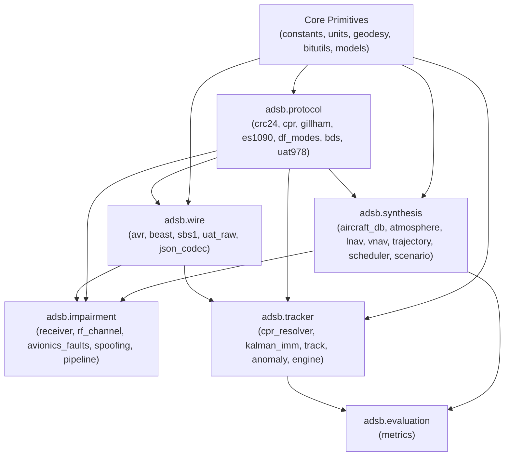

# 01 — Architecture, Geodesy & Domain Design

> **Purpose:** This document defines the repository structure, module dependency rules, coordinate reference systems, geodesy conversion formulas, unit conventions, and core domain data models for the `adsb` Python library.

---

## 1. Repository & Package Layout

The library uses a modern `src/` layout under `src/adsb/` with strict subpackage boundaries:

```text
c:\Projects\libraries\adsb\
├── AGENTS.md                           # AI Coding Agent Master Instructions
├── README.md                           # Overview & Quickstart
├── pyproject.toml                      # PEP 621 config, mypy --strict, ruff, pytest
├── docs/                               # Specification-Driven Development Blueprints
│   ├── 01_ARCHITECTURE_AND_DESIGN.md
│   ├── 02_PROTOCOL_SPECIFICATION.md
│   ├── 03_FLIGHT_SYNTHESIS_AND_PHYSICS.md
│   ├── 04_ERROR_AND_ANOMALY_SIMULATION.md
│   ├── 05_TRACKING_AND_STATE_ESTIMATION.md
│   └── 06_IMPLEMENTATION_ROADMAP_AND_TESTING.md
├── src/
│   └── adsb/
│       ├── __init__.py                 # Public top-level exports
│       ├── constants.py                # Physical, WGS84, ISA, and aviation constants
│       ├── units.py                    # Unit conversion helpers (ft<->m, kt<->m/s, fpm<->m/s)
│       ├── geodesy.py                  # WGS84 <-> ECEF <-> ENU, Vincenty/Haversine, Great Circle
│       ├── bitutils.py                 # 1-based ICAO / 0-based bit extraction & packing primitives
│       ├── models/                     # Shared immutable domain structs
│       │   ├── __init__.py
│       │   ├── common.py               # ICAOAddress, FlightPhase, EmergencyState, AirGroundState
│       │   ├── raw.py                  # RawFrame, ReceptionMetadata, TransmittedFrame
│       │   ├── messages.py             # DecodedMessage hierarchy (DF17, DF4/5/11/20/21, UAT)
│       │   └── truth.py                # AircraftTruthState (kinematic ground truth at time t)
│       ├── wire/                       # Transport / Receiver Wire Format Codecs
│       │   ├── __init__.py
│       │   ├── avr.py                  # Raw AVR ASCII (*8D...;, @0012348D...;)
│       │   ├── beast.py                # Mode S Beast binary framing (0x1A escape, 6-byte MLAT clock)
│       │   ├── sbs1.py                 # Kinetic BaseStation SBS-1 CSV (MSG,1..8)
│       │   ├── uat_raw.py              # 978 MHz UAT raw hex (`-` basic/long, `+` uplink)
│       │   └── json_codec.py           # Structured JSON Lines stream serialization
│       ├── protocol/                   # Stateless Bit-Level Encoders & Decoders
│       │   ├── __init__.py
│       │   ├── crc24.py                # 24-bit Mode S CRC (0xFFF409), syndrome table & correction
│       │   ├── cpr.py                  # Pure math CPR (NL table/formula, encode, global/local decode)
│       │   ├── gillham.py              # Gillham 11-bit Gray code <-> 100ft / 25ft altitude
│       │   ├── charmap.py              # AIS 6-bit callsign character lookup table
│       │   ├── df_modes.py             # Mode S DF0, DF4, DF5, DF11, DF16, DF20, DF21, DF24
│       │   ├── bds.py                  # Comm-B BDS 1,0 / 1,7 / 2,0 / 4,0 / 5,0 / 6,0 encoders/decoders
│       │   ├── es1090.py               # 1090ES DF17/DF18 Type Codes TC 1..31 (DO-260B/C)
│       │   └── uat978.py               # 978 MHz UAT ADS-B (Basic 18B, Long 34B, Reed-Solomon)
│       ├── synthesis/                  # Flight Physics & Squitter Stream Generation
│       │   ├── __init__.py
│       │   ├── aircraft_db.py          # BADA-style performance envelopes (B738, A320, C172, etc.)
│       │   ├── atmosphere.py           # ISA atmosphere, pressure/density altitude, 3D wind field
│       │   ├── lnav.py                 # Waypoint sequencing, fly-by turn anticipation, holding patterns
│       │   ├── vnav.py                 # Vertical profile state machine (Takeoff -> Landing)
│       │   ├── trajectory.py           # 4D kinematic integrator producing AircraftTruthState(t)
│       │   ├── scheduler.py            # DO-260C / UAT squitter & SSR interrogation timers + jitter
│       │   └── scenario.py             # Multi-flight ScenarioSimulator orchestrator
│       ├── impairment/                 # RF Channel & Avionics Fault Injection
│       │   ├── __init__.py
│       │   ├── receiver.py             # ReceiverSite, antenna patterns, radio horizon, terrain mask
│       │   ├── rf_channel.py           # FSPL, SNR, bit error bursts, FRUIT Poisson generator, GARBLE
│       │   ├── avionics_faults.py      # Stale GPS, CPR odd/even desync, Gillham stuck bits, NIC drop
│       │   ├── spoofing.py             # Ghost injection, shadow hijacking, replay attacks
│       │   └── pipeline.py             # Composable ImpairmentPipeline
│       ├── tracker/                    # Stateful Multi-Target Tracking & Anomaly Detection
│       │   ├── __init__.py
│       │   ├── cpr_resolver.py         # Per-aircraft stateful Global (10s window) & Local CPR resolver
│       │   ├── kalman_imm.py           # IMM-EKF/UKF (Constant Velocity + Coordinated Turn in ENU)
│       │   ├── track.py                # TrackState, TrackLifecycle (Tentative/Confirmed/Coasting)
│       │   ├── anomaly.py              # Kinematic plausibility, CPR jump, & spoof detector
│       │   └── engine.py               # MultiTargetTracker top-level engine
│       └── evaluation/                 # Closed-Loop Benchmarking (Truth vs. Track)
│           ├── __init__.py
│           └── metrics.py              # Position/Velocity RMSE, track completeness, latency, false alarms
└── tests/
    ├── unit/                           # Deterministic unit & golden vector tests
    ├── property/                       # Hypothesis property-based round-trip tests
    └── integration/                    # Full closed-loop synthesis -> impairment -> decode -> track
```

---

## 2. Strict Architectural Dependency DAG

To guarantee that ground-truth simulation data **never** leaks into the decoder or tracker, module imports must strictly obey this Directed Acyclic Graph (DAG):



> [!CAUTION]
> **Hard Architectural Invariant:**
> `adsb.protocol`, `adsb.wire`, and `adsb.tracker` **MUST NOT** import anything from `adsb.synthesis`, `adsb.impairment`, or `adsb.models.truth`. Enforce this with a dedicated unit test in `tests/unit/test_architecture_imports.py`.

---

## 3. Physical, Geodetic & Aviation Constants (`src/adsb/constants.py`)

All modules must import physical constants from `adsb.constants` rather than redefining magic numbers:

| Constant Name | Exact Value | Units | Description |
| :--- | :--- | :--- | :--- |
| `SPEED_OF_LIGHT_MPS` | `299_792_458.0` | $\text{m/s}$ | Speed of light in vacuum ($c$) |
| `WGS84_A_M` | `6_378_137.0` | $\text{m}$ | WGS84 semi-major axis (equatorial radius $a$) |
| `WGS84_F` | `1.0 / 298.257223563` | dimensionless | WGS84 flattening ($f$) |
| `WGS84_B_M` | `6_356_752.314245179` | $\text{m}$ | WGS84 semi-minor axis ($b = a(1 - f)$) |
| `WGS84_E2` | `6.6943799901413165e-3` | dimensionless | First eccentricity squared ($e^2 = f(2 - f)$) |
| `EARTH_MEAN_RADIUS_M` | `6_371_008.8` | $\text{m}$ | IUGG mean spherical radius ($R_E$) |
| `EFFECTIVE_EARTH_RADIUS_FACTOR` | `4.0 / 3.0` | dimensionless | Standard atmospheric refraction factor ($k = 4/3$) for RF line-of-sight |
| `GRAVITY_MPS2` | `9.80665` | $\text{m/s}^2$ | Standard gravitational acceleration ($g_0$) |
| `ISA_T0_K` | `288.15` | $\text{K}$ | ISA sea-level standard temperature ($15^\circ\text{C}$) |
| `ISA_P0_PA` | `101_325.0` | $\text{Pa}$ | ISA sea-level standard pressure ($1013.25\text{ hPa}$) |
| `ISA_RHO0_KGPM3` | `1.225` | $\text{kg/m}^3$ | ISA sea-level air density |
| `ISA_LAPSE_RATE_KPM` | `0.0065` | $\text{K/m}$ | Tropospheric temperature lapse rate ($L$, below $11,000\text{ m}$) |
| `GAS_CONSTANT_AIR` | `287.05287` | $\text{J/(kg}\cdot\text{K)}$ | Specific gas constant for dry air ($R_{\text{air}}$) |
| `GAMMA_AIR` | `1.4` | dimensionless | Ratio of specific heats for dry air ($\gamma$) |
| `FEET_TO_METERS` | `0.3048` | $\text{m/ft}$ | Exact international foot definition |
| `METERS_TO_FEET` | `1.0 / 0.3048` | $\text{ft/m}$ | Inverse foot conversion |
| `NM_TO_METERS` | `1852.0` | $\text{m/NM}$ | Exact international nautical mile |
| `KNOTS_TO_MPS` | `1852.0 / 3600.0` | $(\text{m/s})/\text{kt}$ | Knots to meters per second ($\approx 0.5144444$) |
| `FPM_TO_MPS` | `0.3048 / 60.0` | $(\text{m/s})/\text{fpm}$ | Feet per minute to meters per second ($\approx 0.00508$) |
| `FREQ_1090ES_HZ` | `1_090_000_000.0` | $\text{Hz}$ | Mode S / 1090ES carrier frequency |
| `FREQ_UAT_HZ` | `978_000_000.0` | $\text{Hz}$ | Universal Access Transceiver carrier frequency |

---

## 4. Coordinate Reference Systems & Geodesy (`src/adsb/geodesy.py`)

The library operates across three primary coordinate frames:

1. **WGS84 Geodetic ($\phi, \lambda, h$):**
   - Latitude $\phi \in [-90^\circ, +90^\circ]$, Longitude $\lambda \in [-180^\circ, +180^\circ)$, Height $h$ in meters above the WGS84 ellipsoid (or MSL when explicitly noted).
   - Used for flight plans, waypoints, ADS-B CPR encoding/decoding, and user-facing output.
2. **ECEF (Earth-Centered, Earth-Fixed Cartesian $X, Y, Z$ in meters):**
   - Used for 3D slant-range distance, line-of-sight vector intersection with the Earth ellipsoid, and Time Difference of Arrival (TDOA / MLAT) calculations.
3. **Local Tangent Plane ENU (East $e$, North $n$, Up $u$ in meters):**
   - Anchored at a local reference origin $(\phi_0, \lambda_0, h_0)$ (either the receiver site or the track's initial confirmation point).
   - Used by the **Kalman Filter (`adsb.tracker.kalman_imm`)** and **turn-anticipation LNAV solver** so linear matrix kinematics work in flat Euclidean meters without high-latitude meridian convergence distortions.

### 4.1 Geodetic ($\phi, \lambda, h$) $\rightarrow$ ECEF ($X, Y, Z$)
Given $\phi, \lambda$ in radians and ellipsoidal height $h$ in meters:
$$N(\phi) = \frac{a}{\sqrt{1 - e^2 \sin^2\phi}}$$
$$\begin{aligned}
X &= (N(\phi) + h) \cos\phi \cos\lambda \\
Y &= (N(\phi) + h) \cos\phi \sin\lambda \\
Z &= \left(N(\phi)(1 - e^2) + h\right) \sin\phi
\end{aligned}$$

### 4.2 ECEF ($X, Y, Z$) $\rightarrow$ Geodetic ($\phi, \lambda, h$) (Bowring / Ferrari-Heikkinen Closed/Iterative Method)
Use Bowring's method (2 iterations achieve sub-millimeter precision everywhere near Earth):
$$p = \sqrt{X^2 + Y^2}, \quad \lambda = \operatorname{atan2}(Y, X)$$
$$e'^2 = \frac{a^2 - b^2}{b^2}, \quad \theta = \operatorname{atan2}(Z \cdot a, \, p \cdot b)$$
$$\phi = \operatorname{atan2}\!\left(Z + e'^2 b \sin^3\theta, \; p - e^2 a \cos^3\theta\right)$$
$$N(\phi) = \frac{a}{\sqrt{1 - e^2 \sin^2\phi}}, \quad h = \frac{p}{\cos\phi} - N(\phi)$$
*(For $|\phi| > 89.9^\circ$ near the poles, compute $h = \frac{Z}{\sin\phi} - N(\phi)(1 - e^2)$ to avoid division by $\cos\phi \approx 0$.)*

### 4.3 ECEF $\leftrightarrow$ Local ENU Transformation
Given an origin $(\phi_0, \lambda_0, h_0)$ with ECEF coordinates $\mathbf{r}_0 = [X_0, Y_0, Z_0]^T$ and a target point $\mathbf{r} = [X, Y, Z]^T$, define $\Delta\mathbf{r} = \mathbf{r} - \mathbf{r}_0$ and the orthonormal rotation matrix $\mathbf{R}_{\text{ECEF}\to\text{ENU}}(\phi_0, \lambda_0)$:
$$\mathbf{R}_{\text{ECEF}\to\text{ENU}} = \begin{bmatrix}
-\sin\lambda_0 & \cos\lambda_0 & 0 \\
-\sin\phi_0\cos\lambda_0 & -\sin\phi_0\sin\lambda_0 & \cos\phi_0 \\
\cos\phi_0\cos\lambda_0 & \cos\phi_0\sin\lambda_0 & \sin\phi_0
\end{bmatrix}$$
$$\begin{bmatrix} e \\ n \\ u \end{bmatrix} = \mathbf{R}_{\text{ECEF}\to\text{ENU}} \, \Delta\mathbf{r}, \qquad \mathbf{r} = \mathbf{r}_0 + \mathbf{R}_{\text{ECEF}\to\text{ENU}}^T \begin{bmatrix} e \\ n \\ u \end{bmatrix}$$

### 4.4 Great-Circle Distance, Initial Bearing, and Cross-Track Error
For LNAV waypoint navigation on the sphere (mean radius $R_E = 6,371,008.8\text{ m}$):
- **Central Angle $\delta_{12}$ (Haversine):**
  $$\delta_{12} = 2 \arcsin\!\left(\sqrt{\sin^2\!\left(\frac{\Delta\phi}{2}\right) + \cos\phi_1 \cos\phi_2 \sin^2\!\left(\frac{\Delta\lambda}{2}\right)}\right), \quad d = R_E \delta_{12}$$
- **Forward Azimuth (True Course $\theta_{12} \in [0^\circ, 360^\circ)$):**
  $$\theta_{12} = \operatorname{atan2}\!\left(\sin(\Delta\lambda)\cos\phi_2, \; \cos\phi_1\sin\phi_2 - \sin\phi_1\cos\phi_2\cos(\Delta\lambda)\right) \bmod 2\pi$$
- **Cross-Track Distance $d_{\text{xt}}$ and Along-Track Distance $d_{\text{at}}$** (from start waypoint $A$ to end waypoint $B$ for current aircraft position $P$):
  $$\delta_{\text{xt}} = \arcsin\!\left(\sin(\delta_{AP}) \sin(\theta_{AP} - \theta_{AB})\right), \quad d_{\text{xt}} = R_E \delta_{\text{xt}}$$
  $$\delta_{\text{at}} = \arccos\!\left(\frac{\cos\delta_{AP}}{\cos\delta_{\text{xt}}}\right), \quad d_{\text{at}} = R_E \delta_{\text{at}}$$

---

## 5. Core Domain Data Structures (`src/adsb/models/`)

All domain models must be immutable (`@dataclass(frozen=True, slots=True)` for high-throughput hot-path structs, and `pydantic.BaseModel(frozen=True)` for external configuration/flight plans).

### 5.1 Common Enumerations (`src/adsb/models/common.py`)

```python
from enum import IntEnum, StrEnum

class FlightPhase(StrEnum):
    PREFLIGHT_TAXI = "PREFLIGHT_TAXI"
    TAKEOFF_ROLL = "TAKEOFF_ROLL"
    INITIAL_CLIMB = "INITIAL_CLIMB"
    CLIMB = "CLIMB"
    CRUISE = "CRUISE"
    HOLDING = "HOLDING"
    DESCENT = "DESCENT"
    APPROACH = "APPROACH"
    LANDING_ROLLOUT = "LANDING_ROLLOUT"
    ARRIVED_GATE = "ARRIVED_GATE"

class AirGroundState(IntEnum):
    AIRBORNE = 0
    ON_GROUND = 1
    UNCERTAIN = 2

class WakeVortexCategory(StrEnum):
    NO_INFO = "A0"
    LIGHT = "A1"                  # < 15,500 lbs (7,030 kg)
    SMALL = "A2"                  # 15,500 to 75,000 lbs
    LARGE = "A3"                  # 75,000 to 300,000 lbs (e.g., B738, A320)
    HIGH_VORTEX_LARGE = "A4"      # e.g., B757
    HEAVY = "A5"                  # > 300,000 lbs (e.g., B77W, A359)
    HIGH_PERFORMANCE = "A6"       # > 5g capability and > 400 kt
    ROTORCRAFT = "A7"             # Helicopter
    GLIDER = "B1"
    LIGHTER_THAN_AIR = "B2"
    UAV = "B6"
    SURFACE_EMERGENCY_VEHICLE = "C1"
    SURFACE_SERVICE_VEHICLE = "C2"
    SURFACE_OBSTACLE = "C3"

class CPRFormat(IntEnum):
    EVEN = 0
    ODD = 1

class AltitudeSource(StrEnum):
    BAROMETRIC = "BARO"
    GNSS_HAE = "GNSS_HAE"
```

### 5.2 Ground Truth Kinematic State (`src/adsb/models/truth.py`)

Generated at every time step by `adsb.synthesis` and consumed by the squitter encoder and evaluation harness:

```python
from dataclasses import dataclass
from adsb.models.common import FlightPhase, WakeVortexCategory

@dataclass(frozen=True, slots=True)
class AircraftTruthState:
    timestamp_s: float               # Simulation monotonic epoch time (seconds)
    icao_hex: str                    # 6-char uppercase hex (e.g., "A1B2C3")
    callsign: str                    # Up to 8 chars, space-padded (e.g., "BAW112  ")
    squawk: str                      # 4-digit octal string (e.g., "2451", "7700")
    category: WakeVortexCategory
    phase: FlightPhase
    on_ground: bool

    # Geodetic Position
    lat_deg: float                   # [-90.0, 90.0]
    lon_deg: float                   # [-180.0, 180.0)
    alt_msl_m: float                 # True geometric altitude above Mean Sea Level (m)
    alt_hae_m: float                 # True geometric height above WGS84 Ellipsoid (m)
    alt_baro_ft: float               # Pressure altitude (1013.25 hPa standard datum, ft)
    alt_mcp_selected_ft: float       # Autopilot MCP/FCU selected target altitude (ft)

    # Velocities & Attitude
    groundspeed_mps: float           # Speed over ground (m/s)
    tas_mps: float                   # True Airspeed (m/s)
    ias_mps: float                   # Indicated Airspeed (m/s)
    mach: float                      # Mach number
    true_track_deg: float            # Ground track angle [0, 360) deg true
    magnetic_heading_deg: float      # Aircraft nose magnetic heading [0, 360) deg
    true_heading_deg: float          # Aircraft nose true heading [0, 360) deg
    vertical_rate_baro_mps: float    # Barometric vertical rate (m/s)
    vertical_rate_geom_mps: float    # Geometric/inertial vertical rate (m/s)
    roll_angle_deg: float            # Bank angle (+right wing down, -left wing down)
    track_angle_rate_dps: float      # Rate of change of true track (deg/s)

    # Avionics Quality Indicators
    nic: int = 8                     # Navigation Integrity Category (0..11)
    nac_p: int = 9                   # Navigation Accuracy Category - Position (0..11)
    nac_v: int = 2                   # Navigation Accuracy Category - Velocity (0..4)
    sil: int = 3                     # Source Integrity Level (0..3)
    sda: int = 2                     # System Design Assurance (0..3)
    qnh_hpa: float = 1013.25         # Altimeter subscale baro setting (hPa)
```

### 5.3 Raw Wire Frame & Reception Metadata (`src/adsb/models/raw.py`)

```python
from dataclasses import dataclass
from enum import StrEnum

class TransportType(StrEnum):
    MODES_SHORT_56 = "MODES_56"      # 7 bytes (56 bits): DF 0, 4, 5, 11
    MODES_LONG_112 = "MODES_112"     # 14 bytes (112 bits): DF 16, 17, 18, 20, 21, 24
    UAT_BASIC_144 = "UAT_BASIC"      # 18 bytes payload (+ 12B FEC = 30B over air)
    UAT_LONG_272 = "UAT_LONG"        # 34 bytes payload (+ 14B FEC = 48B over air)

@dataclass(frozen=True, slots=True)
class RawReceptionEvent:
    raw_bytes: bytes                 # Exact payload bytes (7, 14, 18, or 34 bytes)
    transport: TransportType
    rx_timestamp_s: float            # Receiver arrival timestamp (seconds)
    mlat_counter_12mhz: int | None = None  # 48-bit 12MHz Beast MLAT counter if available
    rx_id: str = "DEFAULT_RX"        # Identifier of receiving station
    rssi_dbfs: float | None = None   # Signal level in dBFS (e.g., -18.5 dBFS)
    snr_db: float | None = None      # Signal-to-Noise Ratio at demodulator (dB)
    bit_errors_corrected: int = 0    # Number of bits corrected by CRC syndrome / RS FEC
```

### 5.4 Decoded Protocol Message Hierarchy (`src/adsb/models/messages.py`)

Every decoded message inherits from `DecodedMessageBase` and provides typed fields for downstream tracking:

```python
from dataclasses import dataclass
from adsb.models.common import AirGroundState, AltitudeSource, CPRFormat, WakeVortexCategory

@dataclass(frozen=True, slots=True)
class DecodedMessageBase:
    raw_bytes: bytes
    rx_timestamp_s: float
    rx_id: str
    rssi_dbfs: float | None
    icao_hex: str                    # 6-char hex address (extracted from AA or recovered from AP)
    icao_from_parity: bool           # True if ICAO was XOR-recovered from AP field (DF0/4/5/16/20/21)
    crc_valid: bool                  # True if CRC syndrome == 0 (or valid against known ICAO cache)
    crc_syndrome: int                # 24-bit remainder

@dataclass(frozen=True, slots=True)
class ESIdentificationMsg(DecodedMessageBase):
    """1090ES DF17/18 Type Code 1..4: Aircraft Identification and Category."""
    df: int                          # 17 or 18
    tc: int                          # 1..4
    ca: int                          # Capability / Subtype (0..7)
    callsign: str                    # Cleaned 8-char callsign
    category: WakeVortexCategory

@dataclass(frozen=True, slots=True)
class ESSurfacePositionMsg(DecodedMessageBase):
    """1090ES DF17/18 Type Code 5..8: Surface Position."""
    df: int
    tc: int                          # 5..8
    movement_code: int               # 7-bit ground speed code (0..127)
    groundspeed_kt: float | None     # Decoded groundspeed in knots
    ground_track_valid: bool
    ground_track_deg: float | None   # [0, 360) deg
    time_sync: bool                  # T bit
    cpr_format: CPRFormat            # F bit (0=Even, 1=Odd)
    cpr_lat: int                     # 17-bit encoded latitude [0..131071]
    cpr_lon: int                     # 17-bit encoded longitude [0..131071]
    nic_b: int                       # Derived integrity category

@dataclass(frozen=True, slots=True)
class ESAirbornePositionMsg(DecodedMessageBase):
    """1090ES DF17/18 Type Code 9..18 (Baro) and 20..22 (GNSS HAE)."""
    df: int
    tc: int                          # 9..18 or 20..22
    surveillance_status: int         # 0=No cond, 1=Permanent alert, 2=Temp alert, 3=SPI
    single_antenna_flag: bool        # SAF / NIC supplement-B
    altitude_ft: int | None          # Decoded 25ft or 100ft altitude (None if alt_code == 0)
    altitude_source: AltitudeSource  # BARO (TC 9-18) or GNSS_HAE (TC 20-22)
    q_bit: bool                      # True = 25ft increments, False = 100ft Gillham increments
    time_sync: bool
    cpr_format: CPRFormat
    cpr_lat: int                     # 17-bit [0..131071]
    cpr_lon: int                     # 17-bit [0..131071]

@dataclass(frozen=True, slots=True)
class ESAirborneVelocityMsg(DecodedMessageBase):
    """1090ES DF17/18 Type Code 19 (Subtypes 1, 2, 3, 4)."""
    df: int
    tc: int                          # Always 19
    subtype: int                     # 1=Groundspeed subsonic, 2=GS supersonic, 3=Airspeed sub, 4=AS super
    intent_change_flag: bool
    ifr_capability_flag: bool
    nac_v: int                       # 3-bit velocity uncertainty
    # Subtype 1 & 2 (Groundspeed vector)
    v_ew_kt: float | None            # East-West velocity (+East, -West) in knots
    v_ns_kt: float | None            # North-South velocity (+North, -South) in knots
    groundspeed_kt: float | None     # Resultant speed in knots
    ground_track_deg: float | None   # Resultant true track [0, 360) deg
    # Subtype 3 & 4 (Heading & Airspeed)
    magnetic_heading_deg: float | None
    airspeed_kt: float | None
    airspeed_is_tas: bool | None     # True=TAS, False=IAS
    # Vertical Rate & Geo-Baro Delta
    vertical_rate_source: AltitudeSource
    vertical_rate_fpm: int | None    # Signed vertical rate in ft/min
    geo_minus_baro_ft: int | None    # Signed (GNSS HAE - Baro Alt) in feet
```

*(Additional message classes `ESTargetStateStatusMsg` (TC 29), `ESOperationalStatusMsg` (TC 31), `ModeSAltitudeReplyMsg` (DF 0/4/16), `ModeSIdentityReplyMsg` (DF 5), `ModeSAllCallReplyMsg` (DF 11), `ModeSCommBReplyMsg` (DF 20/21 with decoded `BDSPayload`), and `UATStateVectorMsg` follow the same immutable pattern and are fully specified in [`docs/02_PROTOCOL_SPECIFICATION.md`](02_PROTOCOL_SPECIFICATION.md).)*

