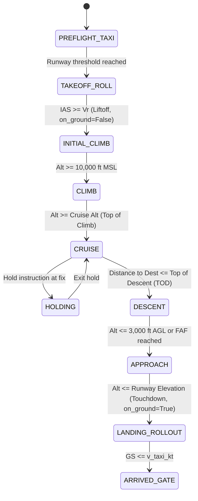

# 03 — Flight Trajectory Synthesis, Physics & Squitter Scheduling

> **Purpose:** This document specifies the mathematical models in `src/adsb/synthesis/` that transform a high-level `FlightPlan` (aircraft type, origin, destination, 4D waypoints, weather) into continuous 4D kinematic ground truth `AircraftTruthState(t)` and schedule-accurate ADS-B / Mode S / UAT squitter transmissions.

---

## 1. Aircraft Performance Database (`src/adsb/synthesis/aircraft_db.py`)

To generate realistic trajectories across diverse aircraft classes without requiring proprietary EUROCONTROL BADA license files, `adsb.synthesis.aircraft_db` ships with a built-in parametric performance database (`AircraftPerformanceProfile`) covering major ICAO type designators, plus support for user-defined custom profiles.

### 1.1 `AircraftPerformanceProfile` Schema

```python
from dataclasses import dataclass
from adsb.models.common import WakeVortexCategory

@dataclass(frozen=True, slots=True)
class AircraftPerformanceProfile:
    type_code: str                   # ICAO designator (e.g., "B738", "A320", "B77W", "C172", "EC35", "F16")
    category: WakeVortexCategory
    # Speed Envelopes (Indicated Airspeed in knots & Mach)
    v_taxi_kt: float                 # Standard taxi groundspeed (e.g., 15.0 kt)
    v_rotate_ias_kt: float           # Takeoff rotation speed Vr (e.g., 145.0 kt)
    v_initial_climb_ias_kt: float    # V2 + 15..20 kt up to 10,000 ft (e.g., 250.0 kt)
    v_climb_ias_kt: float            # Enroute climb IAS above 10,000 ft until crossover (e.g., 290.0 kt)
    mach_climb: float                # Climb Mach above crossover altitude (e.g., 0.78)
    mach_cruise: float               # Typical cruise Mach (e.g., 0.79)
    v_cruise_tas_kt: float           # Typical cruise TAS for non-Mach aircraft (e.g., 122.0 kt for C172)
    mach_descent: float              # Descent Mach above crossover (e.g., 0.78)
    v_descent_ias_kt: float          # Descent IAS below crossover down to 10,000 ft (e.g., 280.0 kt)
    v_approach_ias_kt: float         # Final approach speed Vref + 5 (e.g., 140.0 kt)
    # Altitude & Vertical Rate Envelopes
    service_ceiling_ft: float        # Max certified operating altitude (e.g., 41000.0 ft)
    initial_climb_fpm: float         # Climb rate 0..10,000 ft (e.g., 2800.0 fpm)
    mid_climb_fpm: float             # Climb rate 10,000..24,000 ft (e.g., 2000.0 fpm)
    high_climb_fpm: float            # Climb rate >24,000 ft to ceiling (e.g., 1000.0 fpm)
    normal_descent_fpm: float        # Standard idle/path descent rate (e.g., -2000.0 fpm)
    approach_descent_fpm: float      # 3-degree ILS glidepath rate (~ -700.0 fpm)
    # Longitudinal & Lateral Accelerations / Turn Limits
    takeoff_accel_mps2: float        # Runway longitudinal acceleration (e.g., 2.4 m/s^2)
    landing_decel_mps2: float        # Braking/reverse thrust deceleration (e.g., -2.8 m/s^2)
    enroute_accel_mps2: float        # Smooth speed transition acceleration (e.g., 0.8 m/s^2)
    max_bank_angle_deg: float        # Standard LNAV bank limit (e.g., 25.0 deg)
    max_roll_rate_dps: float         # Roll-in / roll-out rate (e.g., 5.0 deg/s)
```

### 1.2 Built-In Reference Aircraft Profiles

| Type Code | Description | Cat | $V_R$ (kt) | Climb IAS / Mach | Cruise TAS / Mach | Ceiling (ft) | Climb Rate (Low/Mid/High fpm) | Max Bank ($^\circ$) |
| :--- | :--- | :---: | :---: | :---: | :---: | :---: | :---: | :---: |
| **`B738`** | Boeing 737-800 | `A3` | 145 | 250 / 290 / M0.78 | M0.79 (455 kt) | 41,000 | 3000 / 2100 / 1100 | $25^\circ$ |
| **`A320`** | Airbus A320-200 | `A3` | 140 | 250 / 290 / M0.78 | M0.78 (450 kt) | 39,800 | 2900 / 2000 / 1000 | $25^\circ$ |
| **`B77W`** | Boeing 777-300ER | `A5` | 160 | 250 / 310 / M0.82 | M0.84 (485 kt) | 43,100 | 2800 / 2000 / 1000 | $25^\circ$ |
| **`E75L`** | Embraer 175 LR | `A3` | 132 | 240 / 270 / M0.74 | M0.76 (440 kt) | 41,000 | 2700 / 1800 / 900 | $25^\circ$ |
| **`DH8D`** | Dash 8 Q400 (Turboprop) | `A3` | 115 | 210 / 210 / M0.55 | 360 kt | 27,000 | 2200 / 1500 / 800 | $25^\circ$ |
| **`C172`** | Cessna 172 Skyhawk (GA) | `A1` | 55 | 75 / 80 / — | 122 kt | 14,000 | 700 / 400 / — | $20^\circ$ |
| **`SR22`** | Cirrus SR22T | `A1` | 72 | 110 / 120 / — | 185 kt | 25,000 | 1200 / 900 / 500 | $22^\circ$ |
| **`EC35`** | Airbus H135 Helicopter | `A7` | 0 | 70 / 90 / — | 135 kt | 15,000 | 1500 / 900 / — | $30^\circ$ |
| **`F16`** | F-16 Fighting Falcon | `A6` | 155 | 350 / 450 / M0.95 | M1.40 (Supersonic) | 50,000 | 12000 / 8000 / 4000 | $60^\circ$ |

---

## 2. Atmosphere, Altimetry & Wind Triangle (`src/adsb/synthesis/atmosphere.py`)

### 2.1 International Standard Atmosphere (ISA) with Non-Standard Offsets ($\Delta T_{\text{ISA}}, \text{QNH}$)
Given geometric MSL altitude $h_{\text{msl}}$ (m), surface QNH pressure $P_{\text{QNH}}$ (hPa), and temperature deviation $\Delta T_{\text{ISA}}$ (K):
1. **Troposphere ($h_{\text{msl}} \le 11,000\text{ m}$):**
   $$T_{\text{ISA}}(h) = T_0 - L \cdot h_{\text{msl}}, \qquad T(h) = T_{\text{ISA}}(h) + \Delta T_{\text{ISA}}$$
   $$P(h) = P_{\text{QNH}} \cdot 100 \cdot \left( \frac{T_0 - L \cdot h_{\text{msl}}}{T_0} \right)^{\frac{g_0}{R_{\text{air}} L}}$$
2. **Lower Stratosphere ($11,000\text{ m} < h_{\text{msl}} \le 20,000\text{ m}$):**
   $$T_{\text{ISA}}(h) = 216.65\text{ K}, \qquad P(h) = P(11000) \exp\!\left( -\frac{g_0 (h_{\text{msl}} - 11000)}{R_{\text{air}} \cdot 216.65} \right)$$
3. **Density & Speed of Sound:**
   $$\rho(h) = \frac{P(h)}{R_{\text{air}} T(h)}, \qquad a_{\text{sound}}(h) = \sqrt{\gamma R_{\text{air}} T(h)}$$
4. **Barometric Pressure Altitude ($h_{\text{baro,ft}}$ transmitted in ADS-B TC 9..18 and Mode S DF4/20):**
   Transponders always report pressure altitude referenced to standard sea-level pressure $P_0 = 101,325\text{ Pa}$ ($1013.25\text{ hPa}$), regardless of pilot QNH setting:
   $$h_{\text{baro,m}} = \frac{T_0}{L} \left[ 1 - \left( \frac{P(h)}{P_0} \right)^{\frac{R_{\text{air}} L}{g_0}} \right], \qquad h_{\text{baro,ft}} = \frac{h_{\text{baro,m}}}{0.3048}$$
   - Consequently, the **Geo-Minus-Baro Difference ($\Delta h_{\text{geo-baro}}$)** transmitted in TC 19 is naturally and physically consistent:
     $$\Delta h_{\text{geo-baro,ft}} = \frac{h_{\text{hae,m}}}{0.3048} - h_{\text{baro,ft}}$$

### 2.2 Airspeed Conversions (IAS $\leftrightarrow$ TAS $\leftrightarrow$ Mach)
- Given Indicated Airspeed $V_{\text{IAS}}$ (m/s) and Mach $M$:
  $$V_{\text{TAS}} = V_{\text{IAS}} \sqrt{\frac{\rho_0}{\rho(h)}}, \qquad M = \frac{V_{\text{TAS}}}{a_{\text{sound}}(h)}$$
- **Crossover Altitude:** During climb/descent, an aircraft holds constant $V_{\text{IAS}}$ until $V_{\text{TAS}}(V_{\text{IAS}}, h) / a_{\text{sound}}(h)$ reaches target $M_{\text{climb}}$, above which it holds constant Mach.

### 2.3 Wind Triangle (True Track vs. True Heading, Groundspeed vs. TAS)
Given desired ground track angle $\chi$ (radians clockwise from True North), True Airspeed $V_{\text{TAS}}$, and horizontal wind vector $\mathbf{w} = [w_e, w_n]^T$ (where $w_e, w_n$ are East and North wind components in m/s, plus optional Dryden/Ornstein-Uhlenbeck turbulence):
- **Wind Correction Angle ($\text{WCA}$):**
  $$\sin(\text{WCA}) = \frac{w_e \cos\chi - w_n \sin\chi}{V_{\text{TAS}}}$$
- **True Heading ($\psi_T$) and Magnetic Heading ($\psi_M$):**
  $$\psi_T = (\chi - \arcsin(\sin(\text{WCA}))) \bmod 2\pi, \qquad \psi_M = (\psi_T - \delta_{\text{mag}}) \bmod 2\pi$$
- **Groundspeed ($V_{\text{GS}}$):**
  $$V_{\text{GS}} = V_{\text{TAS}} \cos(\text{WCA}) + w_e \sin\chi + w_n \cos\chi$$

---

## 3. LNAV & VNAV 4D Trajectory Synthesis (`src/adsb/synthesis/lnav.py`, `vnav.py`)

### 3.1 LNAV: Fly-By Waypoint Sequencing & Turn Anticipation
Aircraft do not make instantaneous sharp corners at waypoints. For three consecutive waypoints $W_{k-1} \to W_k \to W_{k+1}$ with inbound course $\chi_{\text{in}}$, outbound course $\chi_{\text{out}}$, and course change $\Delta\chi = \operatorname{wrap\_pi}(\chi_{\text{out}} - \chi_{\text{in}})$:
1. **Steady-Turn Radius $R_{\text{turn}}$** at groundspeed $V_{\text{GS}}$ and target bank angle $\phi_{\text{bank}} = \operatorname{sign}(\Delta\chi) \cdot \phi_{\text{max}}$:
   $$R_{\text{turn}} = \frac{V_{\text{GS}}^2}{g_0 \tan|\phi_{\text{bank}}|}$$
2. **Turn Anticipation Lead Distance $d_{\text{lead}}$** before reaching $W_k$:
   $$d_{\text{lead}} = R_{\text{turn}} \tan\!\left(\frac{|\Delta\chi|}{2}\right) + \frac{1}{2} V_{\text{GS}} \frac{|\phi_{\text{bank}}|}{\dot{\phi}_{\text{max}}}$$
3. When distance to $W_k$ drops below $d_{\text{lead}}$, the aircraft smoothly rolls into bank angle $\phi_{\text{bank}}$ at roll rate $\dot{\phi}_{\text{max}}$, follows the circular arc of radius $R_{\text{turn}}$ at turn rate $\dot{\chi} = \frac{g_0 \tan\phi_{\text{bank}}}{V_{\text{GS}}}$, and rolls out onto $\chi_{\text{out}}$.
4. **Holding Patterns (`FlightPhase.HOLDING`):** Standard racetrack loop at a holding fix (1-minute inbound leg below $14,000\text{ ft}$, 1.5-minute inbound leg above $14,000\text{ ft}$, $3^\circ/\text{s}$ or $25^\circ$ bank $180^\circ$ turns).

### 3.2 VNAV: Flight Phase State Machine
The vertical profile progresses through 9 deterministic phases:



- **Top of Descent (`TOD`) Calculation:**
  Computed backward from destination elevation $h_{\text{dest}}$ so the aircraft arrives at the Final Approach Fix ($10\text{ NM}$ out at $3,000\text{ ft}$ AGL) along a smooth idle descent gradient ($\approx 3.0^\circ$, or $\approx 3\text{ NM}$ per $1,000\text{ ft}$ of altitude loss plus $10\text{ NM}$ for deceleration from descent IAS to $250\text{ kt}$ at $10,000\text{ ft}$).

---

## 4. Authentic Squitter & Mode S Interrogation Scheduler (`src/adsb/synthesis/scheduler.py`)

Real transponders do not transmit all fields at once; they run independent asynchronous timers with uniform random jitter as mandated by **RTCA DO-260B/C Section 2.2.3**:

| Message Type | Condition | Nominal Interval ($T_{\text{nom}}$) | Random Jitter Range | Notes |
| :--- | :--- | :---: | :---: | :--- |
| **DF17 Airborne Position (TC 9..18)** | `on_ground == False` | $0.50\text{ s}$ | $\mathcal{U}(0.40\text{ s}, 0.60\text{ s})$ | Strictly alternates `EVEN` ($F=0$) and `ODD` ($F=1$) frames! |
| **DF17 Surface Position (TC 5..8) — Moving** | `on_ground == True` and $\text{GS} > 0.5\text{ kt}$ | $0.50\text{ s}$ | $\mathcal{U}(0.40\text{ s}, 0.60\text{ s})$ | Strictly alternates `EVEN` ($F=0$) and `ODD` ($F=1$). |
| **DF17 Surface Position (TC 5..8) — Stationary** | `on_ground == True` and $\text{GS} \le 0.5\text{ kt}$ | $5.00\text{ s}$ | $\mathcal{U}(4.80\text{ s}, 5.20\text{ s})$ | Alternates `EVEN` and `ODD`. |
| **DF17 Airborne Velocity (TC 19)** | `on_ground == False` | $0.50\text{ s}$ | $\mathcal{U}(0.40\text{ s}, 0.60\text{ s})$ | Subtype 1/2 (GS) default; configurable Subtype 3/4 (HDG/TAS). |
| **DF17 Identification / Callsign (TC 1..4)** | Moving / Airborne | $5.00\text{ s}$ | $\mathcal{U}(4.80\text{ s}, 5.20\text{ s})$ | $10.0\text{ s}$ when stationary on ground. |
| **DF17 Operational Status (TC 31)** | Always | $2.50\text{ s}$ | $\mathcal{U}(2.40\text{ s}, 2.60\text{ s})$ | Or $5.0\text{ s}$ if status unchanged. |
| **DF17 Target State & Status (TC 29)** | Airborne (DO-260B/C) | $1.25\text{ s}$ | $\mathcal{U}(1.15\text{ s}, 1.35\text{ s})$ | Transmits MCP selected altitude, QNH, AP/VNAV/LNAV flags. |
| **DF17 Aircraft Status (TC 28)** | Airborne / Emergency | $5.00\text{ s}$ | $\mathcal{U}(4.80\text{ s}, 5.20\text{ s})$ | Or $0.8\text{ s}$ when emergency squawk (`7500`/`7600`/`7700`) is active. |
| **DF11 Acquisition Squitter** | Always | $1.00\text{ s}$ | $\mathcal{U}(0.80\text{ s}, 1.20\text{ s})$ | 56-bit Mode S All-Call squitter ($II=0$). |
| **DF4 / DF5 / DF20 / DF21 (SSR Replies)** | When within SSR radar range | Radar rotation $T_{\text{SSR}} \in [4.0\text{ s}, 12.0\text{ s}]$ | Beam dwell burst (2–4 replies per sweep) | Simulates secondary surveillance radar interrogating BDS 2,0 / 4,0 / 5,0 / 6,0. |
| **978 MHz UAT ADS-B (Basic / Long)** | UAT-equipped aircraft | $1.00\text{ s}$ (exact 1 Hz MSO) | Pseudo-random Message Start Opportunity (MSO) slot | Rotates Payload Types `[1, 0, 3, 0]` over each 4-second epoch per DO-282B. |

