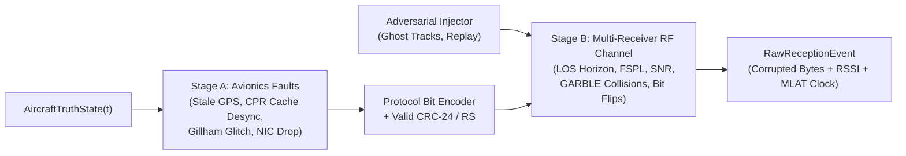

# 04 — Physical RF Channel, Transponder Fault & Anomaly Simulation

> **Purpose:** This document specifies `src/adsb/impairment/`, which injects realistic physical-layer RF channel degradations, avionics/transponder implementation bugs, and adversarial spoofing anomalies between the synthesizer and the decoder/tracker.

---

## 1. Two-Stage Impairment Pipeline Architecture

Anomalies occur at two distinct physical stages and must be modeled accordingly:

1. **Stage A — Pre-Encoding Avionics & Transponder Faults (`adsb.impairment.avionics_faults`):**
   Corrupts the aircraft's sensor inputs or transponder register buffers *before* the 24-bit CRC is calculated. Because the transponder computes a valid CRC over the faulty payload, **these frames pass CRC validation (`crc_valid == True`)** and must be handled or detected by the stateful tracker!
2. **Stage B — Post-Encoding RF Channel & Receiver Impairments (`adsb.impairment.rf_channel`):**
   Operates on the transmitted electromagnetic wave and raw bitstream between the aircraft antenna and each `ReceiverSite`. Causes propagation delay, signal attenuation, horizon/terrain dropouts, overlapping packet collisions (FRUIT/GARBLE), and raw bit flips that **corrupt the wire bits and trigger CRC syndromes (`crc_syndrome != 0`)**.

---

## 2. Stage B: Physical RF Propagation & Channel Model (`src/adsb/impairment/rf_channel.py`)

### 2.1 Slant Range, Propagation Delay & MLAT Clock Drift
Given aircraft ECEF position $\mathbf{r}_{\text{tx}}(t)$ and receiver ECEF position $\mathbf{r}_{\text{rx}}$:
- **True 3D Slant Range ($d_{\text{slant}}$):**
  $$d_{\text{slant}} = \|\mathbf{r}_{\text{tx}}(t) - \mathbf{r}_{\text{rx}}\|_2$$
- **Time of Arrival ($t_{\text{rx}}$) and 12 MHz Beast Counter:**
  $$t_{\text{rx}} = t_{\text{tx}} + \frac{d_{\text{slant}}}{c} + \Delta t_{\text{clock}}(t_{\text{tx}}) + \epsilon_{\text{jitter}}$$
  where $\Delta t_{\text{clock}}(t) = \delta_0 + \alpha_{\text{drift}} \cdot t$ models receiver crystal oscillator offset ($\delta_0$ in seconds) and linear clock drift ($\alpha_{\text{drift}}$ in parts-per-million, e.g., $\pm 20\text{ ppm}$), and $\epsilon_{\text{jitter}} \sim \mathcal{N}(0, \sigma_t^2)$ models timestamping quantization noise ($\sigma_t \approx 15\text{ ns}$).

### 2.2 Refracted Radio Horizon & Azimuth/Elevation Terrain Mask
Using the $k = 4/3$ effective Earth radius model ($R_{\text{eff}} = \frac{4}{3} R_E \approx 8,494,678\text{ m}$), the maximum line-of-sight radio horizon distance $d_{\text{horizon}}$ between receiver altitude $h_{\text{rx}}$ (m MSL) and aircraft altitude $h_{\text{tx}}$ (m MSL) is:
$$d_{\text{horizon}} = \sqrt{2 R_{\text{eff}} \max(h_{\text{rx}}, 0)} + \sqrt{2 R_{\text{eff}} \max(h_{\text{tx}}, 0)}$$
- **Horizon Dropout Rule:** If $d_{\text{slant}} > d_{\text{horizon}}$, or if the aircraft elevation angle $\text{el}_{\text{deg}}$ in the receiver's local ENU frame falls below the receiver's directional terrain obstruction profile $\text{el}_{\text{mask}}(\text{az}_{\text{deg}})$, the frame is **dropped before reception**.

### 2.3 Link Budget, Free-Space Path Loss (FSPL) & SNR
For transmit power $P_{\text{tx,dBm}}$ (e.g., $54.0\text{ dBm} = 250\text{ W}$ for Class A1 airliners; $51.0\text{ dBm} = 125\text{ W}$ for GA), transmit/receive antenna gains $G_{\text{tx,dBi}}, G_{\text{rx,dBi}}$, bank-angle polarization/belly-shadowing loss $L_{\text{att}}(\phi_{\text{bank}}, \text{el})$, and carrier frequency $f_c \in \{1090\text{ MHz}, 978\text{ MHz}\}$:
$$\text{FSPL}_{\text{dB}} = 20 \log_{10}(d_{\text{slant}}) + 20 \log_{10}(f_c) + 20 \log_{10}\!\left(\frac{4\pi}{c}\right)$$
$$P_{\text{rx,dBm}} = P_{\text{tx,dBm}} + G_{\text{tx,dBi}} + G_{\text{rx,dBi}} - \text{FSPL}_{\text{dB}} - L_{\text{atm,dB}} - L_{\text{fading}}$$
where $L_{\text{fading}} \sim \text{Rician}(K) \text{ or } \mathcal{N}(0, \sigma_{\text{shadow}}^2)$ models multipath/scintillation.
- **Thermal Noise Floor ($N_{\text{dBm}}$)** for receiver bandwidth $B = 2.0\text{ MHz}$ and noise figure $\text{NF}_{\text{dB}}$:
  $$N_{\text{dBm}} = -174.0 + 10 \log_{10}(B) + \text{NF}_{\text{dB}} \approx -101.0 + \text{NF}_{\text{dB}}$$
- **Signal-to-Noise Ratio ($\text{SNR}_{\text{dB}}$) & Linear ratio ($\gamma = 10^{\text{SNR}_{\text{dB}}/10}$):**
  $$\text{SNR}_{\text{dB}} = P_{\text{rx,dBm}} - N_{\text{dBm}}$$
- **Preamble Detection Threshold:** A Mode S $8.0\ \mu\text{s}$ preamble requires $\text{SNR}_{\text{dB}} \ge \text{SNR}_{\text{min}}$ (typically $6.0\text{ dB}$). Below $\text{SNR}_{\text{min}}$, preamble detection fails with probability $P_{\text{drop}}(\text{SNR}) = \frac{1}{1 + \exp((\text{SNR}_{\text{dB}} - 6.0)/1.5)}$.
- **Pulse Position Modulation (PPM) Bit Error Rate ($P_b$):**
  For 1090 MHz Manchester/PPM non-coherent envelope detection, individual bit flip probability is:
  $$P_b(\gamma) = \frac{1}{2} \exp\!\left(-\frac{\gamma}{2}\right)$$
  For each of the $N \in \{56, 112\}$ bits in the frame, flip bit $k$ independently with probability $P_b(\gamma)$ (plus an optional Gilbert-Elliott 2-state burst error model for impulsive radar interference).

### 2.4 Overlapping Frame Collisions: FRUIT & GARBLE
1090 MHz is an unslotted ALOHA random-access channel:
- **Duration of a Mode S Frame on Air:**
  - $56\text{-bit}$ short frame: $8\ \mu\text{s}\text{ (preamble)} + 56\ \mu\text{s} = 64.0\ \mu\text{s}$
  - $112\text{-bit}$ long frame: $8\ \mu\text{s}\text{ (preamble)} + 112\ \mu\text{s} = 120.0\ \mu\text{s}$
- **Multi-Flight & Background FRUIT Overlap Detection:**
  In `ImpairmentPipeline`, sort all arriving frames at a receiver by arrival time $t_{\text{rx}}$, plus inject synthetic background FRUIT (False Replies Unsynchronized In Time) as a Poisson arrival process with rate $\lambda_{\text{fruit}}$ (e.g., $0$ to $2000\text{ replies/s}$).
- **GARBLE Physics when Frame $B$ overlaps Frame $A$ ($t_{\text{rx},B} < t_{\text{rx},A} + T_{\text{dur},A}$):**
  Let $\Delta P_{\text{dB}} = P_{\text{rx},A,\text{dBm}} - P_{\text{rx},B,\text{dBm}}$ be the power differential during the overlap window $[t_{\text{start}}, t_{\text{end}}]$:
  1. **Capture Effect ($\Delta P_{\text{dB}} \ge +6.0\text{ dB}$):** Frame $A$ dominates; overlapping bits in $A$ experience elevated bit error probability $P_{b,\text{garble}} = 0.05$. Frame $B$'s preamble is missed (dropped) if its preamble falls inside $A$.
  2. **Destructive Garble ($|\Delta P_{\text{dB}}| < 6.0\text{ dB}$):** Both frames interfere strongly during the overlap window; each bit of Frame $A$ within the overlap window is flipped with probability $P_{b,\text{garble}} = 0.35$.
  3. **Stronger Interferer ($\Delta P_{\text{dB}} \le -6.0\text{ dB}$):** Frame $B$ overwrites Frame $A$'s bits in the overlap window ($P_{b,\text{garble}} = 0.50$), or triggers a receiver re-lock onto Frame $B$'s preamble, truncating/dropping Frame $A$.

---

## 3. Stage A: Avionics & Transponder Fault Catalog (`src/adsb/impairment/avionics_faults.py`)

Each fault below can be enabled per-aircraft or globally via `AvionicsFaultConfig` to stress-test the tracker's resilience:

| Fault ID | Fault Name | Real-World Avionics Mechanism & Mathematical Model | Impact on Downstream Tracker |
| :--- | :--- | :--- | :--- |
| **`AV-01`** | **Stale GPS Position Latch** | GNSS receiver UART freezes for $\Delta t_{\text{freeze}} \sim \mathcal{U}(2\text{ s}, 30\text{ s})$. Transponder continues transmitting valid Even/Odd CPR frames at $2\text{ Hz}$ using frozen $(\phi(t_0), \lambda(t_0))$, while barometric altitude and velocity (`TC=19`) continue updating normally, followed by a sudden position teleport when GNSS recovers. | Tests Kalman Filter innovation gating and velocity-vs-position consistency check. |
| **`AV-02`** | **CPR Odd/Even Register Desync** | Transponder updates its latitude buffer from a new GNSS fix but reads the longitude buffer from the previous GNSS fix ($1\text{ s}$ older), or transmits two consecutive `EVEN` frames without an `ODD` frame. | Causes a transient jump in global CPR longitude or forces local CPR fallback. |
| **`AV-03`** | **CPR Latitude Zone Straddle Anomaly** | Aircraft flying near a $\operatorname{NL}(\phi)$ transition boundary (e.g., $\phi \approx 52.008^\circ$) with noisy GNSS jitter bounces across adjacent $\operatorname{NL}$ zones between Even and Odd frames. | Tests the tracker's mandatory $\operatorname{NL}(\text{Rlat}_0) == \operatorname{NL}(\text{Rlat}_1)$ check and local CPR continuity. |
| **`AV-04`** | **Gillham Gray Code Stuck/Open Wire** | On legacy $Q=0$ (100-ft Gillham) altitude encoders, one of the 11 parallel wires ($C_1, C_2, C_4, A_1 \dots D_4$) is stuck at `0` or `1`, causing deterministic $\pm 100\text{ ft}$ to $\pm 1000\text{ ft}$ altitude cliffs or invalid Gillham codes ($C_1 C_2 C_4 \in \{0, 5, 7\}$). | Tests vertical rate vs. baro altitude outlier rejection and GNSS HAE cross-checking. |
| **`AV-05`** | **Baro / Geometric Altitude Swap or QNH Offset** | Transponder misconfigures `TC` (transmitting GNSS HAE inside `TC=11` Baro Position, or pilot enters wrong QNH affecting `TC=29` target altitude). | Tests $\Delta h_{\text{geo-baro}}$ consistency checks. |
| **`AV-06`** | **Integrity Degradation (GPS Jamming / Interference Zone)** | When an aircraft enters a circular Geographic Jamming Zone $(\phi_{\text{jam}}, \lambda_{\text{jam}}, R_{\text{jam}})$, its `NIC` and `NACp` drop to `0` (`TC=18` "No integrity"), or position noise inflates to $\sigma_{\text{pos}} = 500\text{ m}$ with random walk drift. | Tests dynamic measurement covariance $\mathbf{R}_k$ scaling from `NIC`/`NACp` and coasting logic. |
| **`AV-07`** | **Duplicate / Default ICAO Address (`000000` / `FFFFFF` / Collision)** | Two distinct physical aircraft are misconfigured with the same 24-bit `icao_hex` (a real-world occurrence with unprogrammed transponders or military hexes). | Tests spatial track splitting / multi-hypothesis association when one ICAO produces two widely separated kinematic tracks. |

---

## 4. Adversarial Spoofing & Injection Profiles (`src/adsb/impairment/spoofing.py`)

To support security research and anomaly-detection benchmarking, `adsb.impairment.spoofing` provides four configurable attack generators:

1. **`GhostTrackInjector`:** Injects a completely synthetic aircraft track from a fixed terrestrial SDR transmitter location $\mathbf{r}_{\text{attacker}}$.
   - **Signature:** While the decoded CPR coordinates claim the aircraft is moving along a 300-knot trajectory, the physical RF Time of Arrival ($t_{\text{rx}}$) and `RSSI` correspond to the static transmitter $\mathbf{r}_{\text{attacker}}$, and Doppler/RSSI variance does not match the claimed slant-range change.
2. **`ShadowTrackHijacker`:** Listens to a real aircraft's `icao_hex` and transmits higher-power frames with the same `icao_hex` that gradually diverge laterally or vertically from the real trajectory.
3. **`FloodDenialInjector`:** Broadcasts 50+ random `icao_hex` targets in a geometric ring or grid around an airport to saturate naive trackers.
4. **`ReplayInjector`:** Re-transmits a previously recorded sequence of raw frames shifted in time by $+\Delta T_{\text{replay}}$, with or without CPR coordinate translation.

