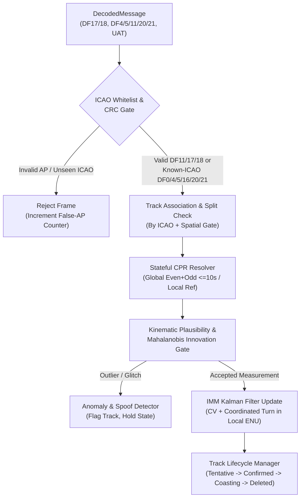
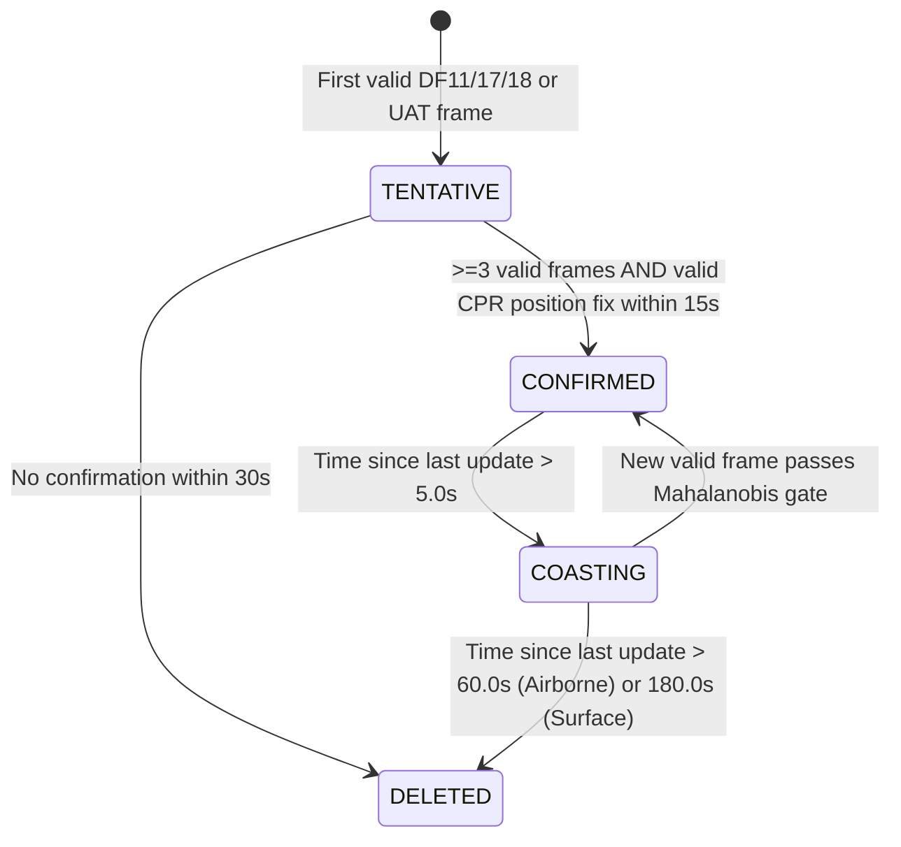

# 05 — Stateful Multi-Target Tracking, CPR Resolution & Anomaly Detection

> **Purpose:** This document specifies `src/adsb/tracker/`, the stateful tracking engine that ingests decoded ADS-B / Mode S / UAT messages, resolves ambiguous CPR coordinates, estimates smoothed 3D position/velocity/turn-rate vectors using an Interacting Multiple Model (IMM) Kalman Filter, manages track lifecycles, and flags avionics faults or spoofing attacks.

---

## 1. Tracker Architecture & Processing Pipeline

---

## 2. Stateful CPR Position Resolution State Machine (`src/adsb/tracker/cpr_resolver.py`)

A single 1090ES position message (`TC` 5..18, 20..22) contains only a 17-bit local grid offset (`cpr_lat`, `cpr_lon`) and a 1-bit parity flag (`EVEN` or `ODD`). The `CPRResolver` maintains per-track state:
- `last_even_frame`: `(cpr_lat, cpr_lon, rx_timestamp_s, on_ground)`
- `last_odd_frame`: `(cpr_lat, cpr_lon, rx_timestamp_s, on_ground)`
- `has_established_position`: `bool`
- `reference_lat_deg`, `reference_lon_deg`: `float | None` (updated on every accepted position fix)

### 2.1 Resolution Rules Upon Receiving Frame $k$ with Parity $F \in \{\text{EVEN}, \text{ODD}\}$
1. **Case A — Track does NOT yet have an established reference position (`has_established_position == False`):**
   - Store Frame $k$ in `last_even_frame` (if $F=\text{EVEN}$) or `last_odd_frame` (if $F=\text{ODD}$).
   - Check if the opposite-parity frame exists with matching `on_ground` state and time separation:
     $$\Delta t_{\text{cpr}} = |t_{\text{even}} - t_{\text{odd}}| \le \begin{cases} 10.0\text{ s} & (\text{Airborne}) \\ 25.0\text{ s} & (\text{Surface}) \end{cases}$$
   - If satisfied, execute **Global CPR Decode** (Section 5.3 / 5.5 of `02_PROTOCOL_SPECIFICATION.md`).
   - Verify $\operatorname{NL}(\text{Rlat}_0) == \operatorname{NL}(\text{Rlat}_1)$ and verify that the decoded position lies within $600\text{ km}$ of the receiving station (if receiver coordinates are known).
   - **Double-Verification (Anti-False-Fix Rule):** Before marking `has_established_position = True`, either require a second consistent CPR decode or verify that the Local CPR decode of both the Even and Odd frames using $(\phi_{\text{global}}, \lambda_{\text{global}})$ reproduces $(\phi_{\text{global}}, \lambda_{\text{global}})$ within $10\text{ m}$.
2. **Case B — Track ALREADY has an established reference position (`has_established_position == True`):**
   - Predict the reference position forward to $t_k$ using the track's current velocity vector:
     $$(\phi_{\text{ref}}, \lambda_{\text{ref}}) = \text{extrapolate}(\phi_{k-1}, \lambda_{k-1}, \mathbf{v}_{k-1}, t_k - t_{k-1})$$
   - Execute **Local CPR Decode** (Section 5.4 of `02_PROTOCOL_SPECIFICATION.md`) around $(\phi_{\text{ref}}, \lambda_{\text{ref}})$.
   - Also execute **Global CPR Decode** if the opposite-parity frame is within $\le 10.0\text{ s}$.
   - **Cross-Check:**
     - If both Global and Local CPR succeed and agree within $3.0\text{ km}$, use the Local/Global result and update the opposite-parity cache.
     - If Global CPR fails the $\operatorname{NL}$ zone-straddle check (e.g., Fault `AV-03`), seamlessly use the **Local CPR** result!
     - If Global CPR disagrees with Local CPR by $> 5.0\text{ km}$ (e.g., Fault `AV-02` register desync or `AV-01` stale latch recovery), compare both against the Kalman predicted position via Mahalanobis gating and increment `cpr_desync_count`.

---

## 3. Interacting Multiple Model (IMM) Kalman Filter (`src/adsb/tracker/kalman_imm.py`)

Aircraft alternate between straight-and-level flight (**Constant Velocity, CV**) and banked horizontal turns or vertical pitch changes (**Coordinated Turn / Constant Acceleration, CT**). A single-model CV filter lags behind turns, while a high-noise filter is too jittery in cruise. Therefore, `adsb.tracker` uses a 2-model **IMM Filter** operating in the track's local tangent **ENU (East, North, Up in meters)** coordinate frame anchored at $(\phi_0, \lambda_0, h_0)$.

### 3.1 State Vector $\mathbf{x} \in \mathbb{R}^7$
$$\mathbf{x} = \begin{bmatrix} e & n & u & v_e & v_n & v_u & \omega \end{bmatrix}^T$$
where:
- $(e, n, u)$: East, North, Up position in meters relative to track ENU origin $(\phi_0, \lambda_0, h_0)$.
- $(v_e, v_n, v_u)$: East, North, Up velocity components in $\text{m/s}$.
- $\omega$: Horizontal turn rate in $\text{rad/s}$ (positive counter-clockwise in ENU, i.e., $\dot{\chi}_{\text{rad/s}} = -\omega$).

### 3.2 Model 1: Constant Velocity (CV, $\omega = 0$)
For time step $\Delta t = t_k - t_{k-1}$:
$$\mathbf{F}_{\text{CV}}(\Delta t) = \begin{bmatrix}
1 & 0 & 0 & \Delta t & 0 & 0 & 0 \\
0 & 1 & 0 & 0 & \Delta t & 0 & 0 \\
0 & 0 & 1 & 0 & 0 & \Delta t & 0 \\
0 & 0 & 0 & 1 & 0 & 0 & 0 \\
0 & 0 & 0 & 0 & 1 & 0 & 0 \\
0 & 0 & 0 & 0 & 0 & 1 & 0 \\
0 & 0 & 0 & 0 & 0 & 0 & 0
\end{bmatrix}$$
Process noise covariance $\mathbf{Q}_{\text{CV}}(\Delta t)$ uses low spectral density $\sigma_{a,\text{horiz}} = 0.3\text{ m/s}^2$, $\sigma_{a,\text{vert}} = 0.2\text{ m/s}^2$.

### 3.3 Model 2: Coordinated Turn (CT, EKF / Exact Discretization for $\omega \ne 0$)
When $|\omega| > 10^{-4}\text{ rad/s}$, horizontal state transition is:
$$\begin{bmatrix} e_{k} \\ n_{k} \\ v_{e,k} \\ v_{n,k} \end{bmatrix} =
\begin{bmatrix}
1 & 0 & \frac{\sin(\omega\Delta t)}{\omega} & -\frac{1 - \cos(\omega\Delta t)}{\omega} \\
0 & 1 & \frac{1 - \cos(\omega\Delta t)}{\omega} & \frac{\sin(\omega\Delta t)}{\omega} \\
0 & 0 & \cos(\omega\Delta t) & -\sin(\omega\Delta t) \\
0 & 0 & \sin(\omega\Delta t) & \cos(\omega\Delta t)
\end{bmatrix}
\begin{bmatrix} e_{k-1} \\ n_{k-1} \\ v_{e,k-1} \\ v_{n,k-1} \end{bmatrix}$$
(When $|\omega| \le 10^{-4}\text{ rad/s}$, use the Taylor series limit $\frac{\sin(\omega\Delta t)}{\omega} \approx \Delta t$ and $\frac{1-\cos(\omega\Delta t)}{\omega} \approx \frac{1}{2}\omega\Delta t^2$).
Process noise $\mathbf{Q}_{\text{CT}}(\Delta t)$ uses maneuvering spectral density $\sigma_{a,\text{horiz}} = 2.5\text{ m/s}^2$, $\sigma_{a,\text{vert}} = 1.0\text{ m/s}^2$, $\sigma_{\dot{\omega}} = 0.015\text{ rad/s}^2$.

### 3.4 Mode Transition Probability Matrix $\boldsymbol{\Pi}$
$$\boldsymbol{\Pi} = \begin{bmatrix} \pi_{11} & \pi_{12} \\ \pi_{21} & \pi_{22} \end{bmatrix} = \begin{bmatrix} 0.95 & 0.05 \\ 0.10 & 0.90 \end{bmatrix}$$

### 3.5 Asynchronous Measurement Updates by Message Type
Because ADS-B transmits position and velocity in separate frames at different timestamps:
1. **Airborne/Surface Position Update (`TC` 5..18, 20..22, UAT):**
   - Observation vector $\mathbf{z}_{\text{pos}} = [e_{\text{meas}}, n_{\text{meas}}, u_{\text{meas}}]^T$, linear matrix $\mathbf{H}_{\text{pos}} = [\mathbf{I}_{3\times 3} \mid \mathbf{0}_{3\times 4}]$.
   - Dynamic Measurement Noise $\mathbf{R}_{\text{pos}} = \operatorname{diag}(\sigma_h^2, \sigma_h^2, \sigma_u^2)$ where $\sigma_h$ is mapped directly from the aircraft's reported `NACp` (or `TC` / `NIC` if `NACp` not yet received):
     - `NACp = 11`: $\sigma_h = 1.5\text{ m}$; `NACp = 10`: $\sigma_h = 5.0\text{ m}$; `NACp = 9`: $\sigma_h = 15.0\text{ m}$; `NACp = 8`: $\sigma_h = 45.0\text{ m}$; `NACp <= 7`: $\sigma_h = 150.0\text{ m}$.
     - $\sigma_u = 7.6\text{ m}$ ($25\text{ ft}$ when $Q=1$) or $30.5\text{ m}$ ($100\text{ ft}$ when $Q=0$).
   - **Baro vs. Geometric Altitude Reconciliation:** Maintain a running exponential moving average of $\Delta h_{\text{geo-baro}}$ from `TC=19` so both Baro (`TC 9..18`, `DF4/20`) and Geometric (`TC 20..22`) altitudes update a unified vertical state $u$ without step discontinuities.
2. **Airborne Groundspeed Velocity Update (`TC=19` Subtype 1 & 2, UAT, or Comm-B `BDS 5,0`):**
   - Observation vector $\mathbf{z}_{\text{vel}} = [v_{e,\text{meas}}, v_{n,\text{meas}}, v_{u,\text{meas}}]^T$, linear matrix $\mathbf{H}_{\text{vel}} = [\mathbf{0}_{3\times 3} \mid \mathbf{I}_{3\times 3} \mid \mathbf{0}_{3\times 1}]$.
   - $\mathbf{R}_{\text{vel}} = \operatorname{diag}(\sigma_v^2, \sigma_v^2, \sigma_{vu}^2)$ mapped from `NACv` ($\sigma_v = 1.0\text{ m/s}$ for `NACv=2`, $3.0\text{ m/s}$ for `NACv=1`).
3. **Comm-B `BDS 5,0` Turn Rate Update:**
   - Directly observes $\omega_{\text{meas}} = -\text{track\_angle\_rate\_rad\_s}$ (or derives $\omega = -\frac{g_0 \tan\phi_{\text{roll}}}{V_{\text{GS}}}$ from roll angle) via $\mathbf{H}_{\omega} = [0, 0, 0, 0, 0, 0, 1]$.
4. **Altitude-Only Update (`DF0`, `DF4`, `DF16`, `DF20`):**
   - Scalar observation $z_u = u_{\text{meas}}$, $\mathbf{H}_{\text{alt}} = [0, 0, 1, 0, 0, 0, 0]$.

---

## 4. Track Lifecycle Management (`src/adsb/tracker/track.py`)

Each tracked aircraft transitions through a 4-state lifecycle:

---

## 5. Kinematic Plausibility, Fault & Spoofing Detection (`src/adsb/tracker/anomaly.py`)

Every incoming message and track update is evaluated against 6 automated detectors, populating `track.anomaly_flags: set[AnomalyType]`:

1. **`KINEMATIC_TELEPORT` (Mahalanobis & Maximum Speed Gate):**
   - Compute innovation $\mathbf{y}_k = \mathbf{z}_k - \mathbf{H}_k \hat{\mathbf{x}}_{k|k-1}$ and innovation covariance $\mathbf{S}_k = \mathbf{H}_k \mathbf{P}_{k|k-1} \mathbf{H}_k^T + \mathbf{R}_k$.
   - Compute squared Mahalanobis distance $d_M^2 = \mathbf{y}_k^T \mathbf{S}_k^{-1} \mathbf{y}_k$.
   - If $d_M^2 > \chi^2_{3, 0.999} = 16.27$ **and** implied horizontal speed $\frac{\|\Delta\mathbf{p}_h\|}{\Delta t} > V_{\text{max}}(\text{category})$ (e.g., $350\text{ m/s}$ subsonic, $800\text{ m/s}$ supersonic):
     - Reject the outlier measurement (do not corrupt filter state).
     - Increment `consecutive_outliers`. If $3+$ consecutive consistent measurements arrive at the new location, either flag `STALE_GPS_RECOVERY` (if displacement matches $\mathbf{v} \cdot \Delta t_{\text{stale}}$) or split a secondary shadow track (`DUPLICATE_ICAO_OR_SPOOF`).
2. **`STALE_GPS_LATCH` (`AV-01` Detector):**
   - Triggered when $\ge 4$ consecutive airborne position frames report identical `(cpr_lat, cpr_lon)` while `TC=19` groundspeed $> 30\text{ kt}$.
3. **`VELOCITY_POSITION_MISMATCH`:**
   - Compares finite-difference velocity from CPR positions $\hat{\mathbf{v}}_{\text{pos}}$ over a $5\text{ s}$ sliding window against reported `TC=19` velocity $\mathbf{v}_{\text{tc19}}$. Flagged if $\|\hat{\mathbf{v}}_{\text{pos}} - \mathbf{v}_{\text{tc19}}\|_2 > 25\text{ m/s}$ persistently.
4. **`ALTITUDE_CLIFF_GILLHAM` (`AV-04` Detector):**
   - Triggered when a single-step altitude change $|\Delta h| \ge 300\text{ ft}$ in $< 1.5\text{ s}$ implies $|\dot{h}| > 12,000\text{ fpm}$ while reported `TC=19` vertical rate is normal ($|\text{VR}| < 3,000\text{ fpm}$).
5. **`CPR_PARITY_OR_ZONE_GLITCH` (`AV-02` / `AV-03` Detector):**
   - Triggered when Global CPR fails the $\operatorname{NL}$ straddle test or diverges from Local CPR by $> 5\text{ km}$.
6. **`RF_PHYSICAL_SPOOF` (Ghost / Static Transmitter Detector):**
   - When reception metadata includes `rssi_dbfs` or `mlat_counter_12mhz`: checks whether the claimed 3D slant range change $\Delta d_{\text{slant}}(t)$ from a 100+ km track movement contradicts a constant `RSSI` variance or static time-of-arrival residual.

