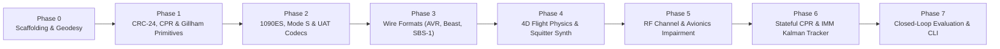

# 06 — Phased Implementation Roadmap, Property Testing & Verification Suite

> **Purpose:** This document provides an actionable, step-by-step execution plan for AI coding agents to build the `adsb` library from scratch, with explicit acceptance criteria, `hypothesis` property-based test invariants, and closed-loop simulation benchmarks at every phase.

---

## 1. Phased Implementation Plan

Execute the phases below in strict sequential order. **Do not start Phase $N+1$ until Phase $N$ passes `pytest`, `mypy --strict`, and `ruff check` with zero errors.**

---

### Phase 0: Project Scaffolding, Constants, Geodesy & Domain Models
- **Files to Create:**
  - `pyproject.toml` (Python $\ge 3.11$, `numpy`, `scipy`, `pydantic>=2.0`, dev deps: `pytest`, `hypothesis`, `mypy`, `ruff`)
  - `src/adsb/__init__.py`, `src/adsb/constants.py`, `src/adsb/units.py`, `src/adsb/bitutils.py`, `src/adsb/geodesy.py`
  - `src/adsb/models/{__init__,common,raw,messages,truth}.py`
  - `tests/unit/test_bitutils.py`, `tests/unit/test_geodesy.py`, `tests/property/test_geodesy_props.py`
- **Verification & Acceptance Criteria:**
  1. `extract_bits` and `set_bits` round-trip every 1-based bit slice across 56-bit and 112-bit integers.
  2. Geodetic $(\phi, \lambda, h) \rightarrow \text{ECEF} \rightarrow \text{Geodetic}$ round-trips across all latitudes $[-90^\circ, +90^\circ]$ (including poles $|\phi|=90^\circ$ and anti-meridian $\lambda=\pm 180^\circ$) with position error $< 10^{-4}\text{ m}$.
  3. Geodetic $\rightarrow \text{ECEF} \rightarrow \text{ENU} \rightarrow \text{ECEF} \rightarrow \text{Geodetic}$ round-trips with error $< 10^{-4}\text{ m}$.

---

### Phase 1: Core Protocol Math — CRC-24, Gillham Gray Code & Pure CPR
- **Files to Create:**
  - `src/adsb/protocol/crc24.py` (byte-table accelerated `compute_crc24`, `compute_syndrome`, single-bit + adjacent 2-bit burst syndrome lookup table)
  - `src/adsb/protocol/gillham.py` (12-bit $Q=1$/$Q=0$ altitude encode/decode, 13-bit Mode S `AC` and `ID` octal squawk encode/decode)
  - `src/adsb/protocol/cpr.py` (`nl_lat`, `encode_cpr_airborne`, `encode_cpr_surface`, `decode_cpr_global_airborne`, `decode_cpr_global_surface`, `decode_cpr_local`)
  - `src/adsb/protocol/charmap.py` (AIS 6-bit callsign encode/decode)
  - `tests/unit/test_crc24.py`, `tests/unit/test_gillham.py`, `tests/unit/test_cpr.py`, `tests/property/test_cpr_props.py`
- **Verification & Acceptance Criteria:**
  1. `compute_crc24` validates all golden vectors (`GV-01`..`GV-06` in `docs/02_PROTOCOL_SPECIFICATION.md`) with syndrome `0`.
  2. Single-bit flip at any of the 112 bit positions in `GV-01` is uniquely identified and corrected back to the original 14 bytes.
  3. Gillham $Q=0$ and $Q=1$ altitude encoding/decoding round-trips every $25\text{ ft}$ step in $[-1000\text{ ft}, 50175\text{ ft}]$ and every $100\text{ ft}$ Gillham step in $[-1000\text{ ft}, 100000\text{ ft}]$.
  4. `GV-02` + `GV-03` global CPR decode yields `(52.25720, 3.91937)` within $10^{-4}\text{ deg}$.
  5. Hypothesis property test: For any $(\phi, \lambda) \in [-85^\circ, +85^\circ] \times [-180^\circ, +180^\circ)$ where $\operatorname{NL}(\text{Rlat}_0) == \operatorname{NL}(\text{Rlat}_1)$, encoding `EVEN` and `ODD` and running Global + Local CPR decode recovers $(\phi, \lambda)$ within the theoretical 17-bit CPR quantization bound ($\le 5.1\text{ m}$ airborne, $\le 1.25\text{ m}$ surface).

---

### Phase 2: Stateless Frame Encoders & Decoders (1090ES, Mode S, Comm-B, UAT)
- **Files to Create:**
  - `src/adsb/protocol/es1090.py` (Encoders & decoders for DF17/DF18 TC 1..4, 5..8, 9..18, 19 [ST 1..4], 20..22, 28, 29, 31)
  - `src/adsb/protocol/df_modes.py` (Encoders & decoders for DF 0, 4, 5, 11, 16, 20, 21, 24)
  - `src/adsb/protocol/bds.py` (Encoders, decoders & heuristic classifier for Comm-B BDS 1,0 / 1,7 / 2,0 / 4,0 / 5,0 / 6,0)
  - `src/adsb/protocol/uat978.py` (978 MHz UAT Basic 18B & Long 34B encoder/decoder + $\text{GF}(2^8)$ Reed-Solomon $\text{RS}(30,18)$ / $\text{RS}(48,34)$ FEC)
  - `src/adsb/protocol/__init__.py` (Unified `decode_frame(raw_bytes, ...)` dispatcher)
  - `tests/unit/test_es1090.py`, `tests/unit/test_df_modes.py`, `tests/unit/test_bds.py`, `tests/unit/test_uat978.py`, `tests/property/test_protocol_roundtrip.py`
- **Verification & Acceptance Criteria:**
  1. All Golden Vectors `GV-01` through `GV-06` decode to exact expected fields.
  2. Every encoder function has a matching decoder function verified by `hypothesis` round-trip tests (`decode(encode(msg)) == msg`).

---

### Phase 3: Transport & Receiver Wire Formats (`src/adsb/wire/`)
- **Files to Create:**
  - `src/adsb/wire/avr.py`, `src/adsb/wire/beast.py`, `src/adsb/wire/sbs1.py`, `src/adsb/wire/uat_raw.py`, `src/adsb/wire/json_codec.py`
  - `tests/unit/test_wire_codecs.py`, `tests/property/test_beast_escaping.py`
- **Verification & Acceptance Criteria:**
  1. Beast binary parser/serializer properly escapes and unescapes arbitrary payloads containing `0x1A` bytes in the 48-bit MLAT timestamp, RSSI byte, and 7/14-byte payload across streaming chunk boundaries.
  2. AVR codec handles both standard `*8D...;` and MLAT `@0011223344558D...;` frames.

---

### Phase 4: 4D Flight Physics & Squitter Stream Synthesis (`src/adsb/synthesis/`)
- **Files to Create:**
  - `src/adsb/synthesis/aircraft_db.py`, `src/adsb/synthesis/atmosphere.py`, `src/adsb/synthesis/lnav.py`, `src/adsb/synthesis/vnav.py`, `src/adsb/synthesis/trajectory.py`, `src/adsb/synthesis/scheduler.py`, `src/adsb/synthesis/scenario.py`
  - `tests/unit/test_synthesis_physics.py`, `tests/unit/test_squitter_scheduler.py`
- **Verification & Acceptance Criteria:**
  1. A synthesized flight from Origin to Destination through $3+$ waypoints transitions smoothly through `PREFLIGHT_TAXI` $\rightarrow$ `TAKEOFF_ROLL` $\rightarrow$ `INITIAL_CLIMB` $\rightarrow$ `CLIMB` $\rightarrow$ `CRUISE` $\rightarrow$ `DESCENT` $\rightarrow$ `APPROACH` $\rightarrow$ `LANDING_ROLLOUT` $\rightarrow$ `ARRIVED_GATE`.
  2. Position derivatives $\frac{d\mathbf{p}}{dt}$ match reported groundspeed and vertical rate within numerical integration tolerance ($< 0.5\text{ m/s}$), and fly-by waypoint turns never exceed `max_bank_angle_deg`.
  3. Squitter scheduler strictly alternates `EVEN` and `ODD` CPR frames at $\mathcal{U}(0.4\text{ s}, 0.6\text{ s})$ airborne and emits all configured DF17/DF11/DF20/DF21/UAT messages at their DO-260C / DO-282B intervals.

---

### Phase 5: RF Channel & Avionics Impairment Pipeline (`src/adsb/impairment/`)
- **Files to Create:**
  - `src/adsb/impairment/receiver.py`, `src/adsb/impairment/rf_channel.py`, `src/adsb/impairment/avionics_faults.py`, `src/adsb/impairment/spoofing.py`, `src/adsb/impairment/pipeline.py`
  - `tests/unit/test_rf_channel.py`, `tests/unit/test_avionics_faults.py`, `tests/unit/test_spoofing.py`
- **Verification & Acceptance Criteria:**
  1. Aircraft beyond the $4/3$-Earth radio horizon $d_{\text{horizon}}$ or masked by terrain are deterministically filtered out.
  2. Overlapping frames within $120\ \mu\text{s}$ at a receiver trigger the GARBLE bit-error/capture model according to their $\Delta P_{\text{dB}}$ power differential.
  3. Avionics faults `AV-01`..`AV-07` produce frames with valid CRCs (`crc_valid == True`) that exhibit the exact specified sensor/register pathologies.

---

### Phase 6: Stateful CPR Resolver, IMM Kalman Tracker & Anomaly Detector (`src/adsb/tracker/`)
- **Files to Create:**
  - `src/adsb/tracker/cpr_resolver.py`, `src/adsb/tracker/kalman_imm.py`, `src/adsb/tracker/track.py`, `src/adsb/tracker/anomaly.py`, `src/adsb/tracker/engine.py`
  - `tests/unit/test_cpr_resolver.py`, `tests/unit/test_kalman_imm.py`, `tests/unit/test_tracker_anomalies.py`
- **Verification & Acceptance Criteria:**
  1. `CPRResolver` refuses to decode Even+Odd pairs separated by $> 10.0\text{ s}$ or straddling a $\operatorname{NL}(\phi)$ boundary, and seamlessly transitions to single-frame Local CPR once a track is confirmed.
  2. DF 0/4/5/16/20/21 frames with `AP` parity are rejected unless the recovered ICAO is already in the active DF11/17/18 whitelist.
  3. The IMM Kalman Filter switches weight toward the Coordinated Turn (CT) model ($\mu_{\text{CT}} > 0.6$) during $25^\circ$ banked turns and back to Constant Velocity (CV) ($\mu_{\text{CV}} > 0.8$) during straight cruise.
  4. All 6 anomaly detectors (`KINEMATIC_TELEPORT`, `STALE_GPS_LATCH`, `VELOCITY_POSITION_MISMATCH`, `ALTITUDE_CLIFF_GILLHAM`, `CPR_PARITY_OR_ZONE_GLITCH`, `RF_PHYSICAL_SPOOF`) accurately flag their corresponding injected faults from Phase 5 with zero false positives on clean flights.

---

### Phase 7: Closed-Loop Evaluation Suite & Reference Scenarios (`src/adsb/evaluation/`)
- **Files to Create:**
  - `src/adsb/evaluation/metrics.py`
  - `tests/integration/test_closed_loop_scenarios.py`
- **Mandatory Closed-Loop Integration Benchmarks (`tests/integration/test_closed_loop_scenarios.py`):**
  1. **Scenario 1 — Ideal Clean Multi-Flight Airspace (10 Aircraft, 30 Minutes):**
     - Mix of `B738`, `A320`, `B77W`, `C172`, `EC35` (including surface taxi, climb, holding pattern, cruise, approach, and UAT traffic) with zero RF impairments.
     - **Target Metrics:** $100\%$ frame decode rate, Horizontal Position RMSE $< 4.0\text{ m}$, Vertical RMSE $< 5.0\text{ m}$, Velocity RMSE $< 0.8\text{ m/s}$, $0$ false tracks, $0$ anomaly flags.
  2. **Scenario 2 — Congested Terminal Airspace with RF Impairments (25 Aircraft, FRUIT = 500 Hz, GARBLE enabled):**
     - **Target Metrics:** Zero unflagged corrupted positions accepted into any confirmed track; Horizontal Position RMSE $< 15.0\text{ m}$ during active reception; track continuity $> 98\%$ across brief garble dropouts.
  3. **Scenario 3 — Avionics Fault & Adversarial Spoofing Stress Test:**
     - Injects `AV-01` (Stale GPS latch), `AV-03` (CPR zone straddle), `AV-04` (Gillham stuck bit), and a `GhostTrackInjector` spoofing attack.
     - **Target Metrics:** Tracker maintains continuous smooth tracks across the CPR zone straddle and Gillham glitch (rejecting the altitude cliff outlier), flags `STALE_GPS_LATCH` and `ALTITUDE_CLIFF_GILLHAM` on the respective aircraft, and flags `RF_PHYSICAL_SPOOF` on the ghost track.

---

## 2. Property-Based Testing Invariants (`tests/property/`)

Use `hypothesis` with `@settings(max_examples=500)` to enforce these mathematical invariants automatically:

1. **Bit Slicing Conservation:** Packing arbitrary bitfields into a 112-bit integer via `set_bits` never mutates adjacent bits outside `[start_1based, end_1based]`.
2. **CRC-24 Linearity & Syndrome Detection:**
   - For any 112-bit valid frame $F$ (`compute_syndrome(F) == 0`) and any error bitmask $E \ne 0$ of length $\le 24$ consecutive bits, `compute_syndrome(F ^ E) != 0` ($100\%$ burst error detection up to 24 bits).
3. **CPR Round-Trip Bounded Quantization Error:**
   - For any $(\phi, \lambda) \in [-85^\circ, +85^\circ] \times [-180^\circ, +180^\circ)$, `decode_cpr_local(encode_cpr_airborne(lat, lon, f), ref_lat=lat, ref_lon=lon)` differs from `(lat, lon)` by at most $\frac{\Delta\text{lat}}{2^{18}} \approx 2.6\text{ m}$ in latitude and $\frac{\Delta\text{lon}}{2^{18}}$ in longitude.
4. **Kalman Covariance Positive-Definiteness:**
   - Across any random sequence of valid asynchronous position (`TC=11`) and velocity (`TC=19`) updates with arbitrary time steps $\Delta t \in [0.05\text{ s}, 30.0\text{ s}]$, the IMM combined covariance matrix $\mathbf{P}_{k|k}$ remains symmetric and strictly positive-definite ($\mathbf{P} = \mathbf{P}^T$, all eigenvalues $\lambda_i(\mathbf{P}) > 0$) using Joseph-form covariance updates:
     $$\mathbf{P}_{k|k} = (\mathbf{I} - \mathbf{K}_k \mathbf{H}_k) \mathbf{P}_{k|k-1} (\mathbf{I} - \mathbf{K}_k \mathbf{H}_k)^T + \mathbf{K}_k \mathbf{R}_k \mathbf{K}_k^T$$

